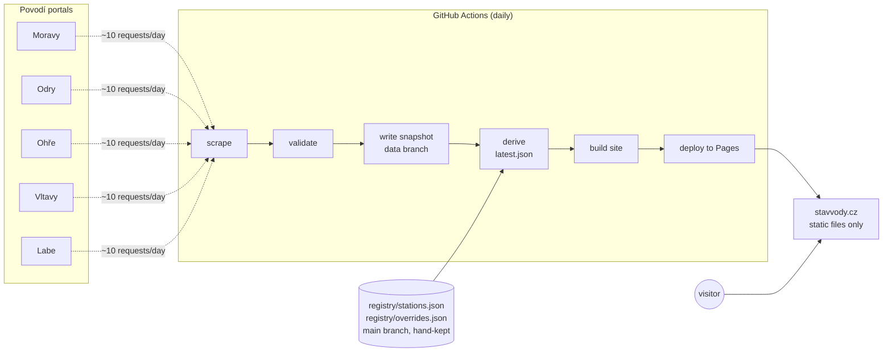

# Design

## Context

See proposal.md for why the site exists, and the specs for what it must do. Constraints that shape the approach:

- The data exists only as HTML tables on five Povodí portals. There is no API. At least four portals run the same MGE Data software with the same three page types.
- The data changes once a day and the audience only reads it.
- Hosting and automation must be free, with no server to maintain.
- All five portals were loaded from a Czech network on 2026-11-22 (`src/scraper/sources.ts` records the findings). From a GitHub-hosted runner the same day, four answered and Povodí Ohře returned a Cloudflare bot challenge (403), so the scraper cannot run entirely on GitHub's runners (Decision 3).
- The project owner has bought the domain stavvody.cz.



## Goals / Non-Goals

**Goals:**

- One scheduled job is the only thing that talks to the portals.
- Every derived number can be regenerated from stored snapshots and the registry.
- The site keeps working, with honest staleness, when the job stops.
- History features and a database can be added later without losing or converting data by hand.

**Non-Goals:**

- No server-side code at request time.
- No history files or charts in this change (planned for v1.1, see Decision 8).
- No runtime map library or tile server.
- No automatic detection of planned drawdowns from portal notes. Notes are stored in every snapshot so their wording can be studied later; `registry/overrides.json` is the only trigger in v1.

## Decisions

### 1. Static site on GitHub Pages, data in the repository

A scheduled GitHub Actions job scrapes, commits a snapshot and redeploys the static site.

Alternatives considered:

| Option | Why not |
|---|---|
| Small server with a database and an API | Hosting cost and upkeep for a once-a-day update; more ways to be offline |
| Serverless functions + object storage | More moving parts and vendor lock-in for the same result |
| Browser calls the portals directly | Puts visitor load on Povodí servers and breaks on cross-origin rules |
| Cloudflare Workers/Pages | Equivalent; worth switching to if the repo must become private or a database (D1) is needed |
| Netlify, Vercel | Bandwidth caps, Vercel's free tier is non-commercial only, nothing gained |

Hosting details:

- Pages source is **GitHub Actions** (`actions/upload-pages-artifact`, `actions/deploy-pages`), so no `CNAME` file is needed.
- Pages on the free plan requires a **public repository**. Code, registry and snapshots are therefore public. Acceptable because the site republishes the same data; relevant while Povodí consent is pending.
- Limits: site ≤ 1 GB (expected < 10 MB), soft bandwidth 100 GB/month (about 200 000 first visits), unlimited Actions minutes for public repos, Pages responses cached for 10 minutes.
- GitHub's terms do not allow Pages primarily for a commercial service. The project is non-commercial.

DNS at the .cz registrar:

| Name | Type | Value |
|---|---|---|
| `stavvody.cz` | A | `185.199.108.153`, `185.199.109.153`, `185.199.110.153`, `185.199.111.153` |
| `stavvody.cz` | AAAA | `2606:50c0:8000::153`, `2606:50c0:8001::153`, `2606:50c0:8002::153`, `2606:50c0:8003::153` |
| `www.stavvody.cz` | CNAME | `<github-user>.github.io.` |

Check these against GitHub's documentation when setting them. Verify the domain in GitHub account settings (TXT record) to prevent takeover, set `stavvody.cz` as the custom domain (www redirects to it), then enable **Enforce HTTPS**.

### 2. Snapshots on a separate `data` branch

```
main                                   data (orphan, bot-only)
├─ openspec/                           ├─ snapshots/2026/2026-11-21.json
├─ design/        canvas exports       └─ status/last-run.json
├─ registry/
│  ├─ stations.json
│  └─ overrides.json
├─ src/
│  ├─ shared/     types, zod schemas, rules, Czech parsing
│  ├─ scraper/    http.ts, portals/mge.ts, sources.ts, run.ts
│  ├─ derive/     latest.ts, run.ts
│  └─ web/        Preact app
├─ public/        map/, fonts/
├─ scripts/       map/ (asset pipeline), registry/ (registry builder)
├─ test/fixtures/<source>/<page>.html
└─ .github/workflows/
```

Why: daily bot commits stay out of the code history, `main` stays small, and the whole data history can be exported by copying one branch.

Raw HTML is **not** committed. Each run uploads the fetched pages as a gzipped Actions artifact kept for 90 days, which satisfies raw page retention without growing the repository.

Alternative considered: snapshots on `main`. Rejected because 365 bot commits a year would bury code changes.

### 3. Scraper on a GitHub-hosted runner; Povodí Ohře paused

The scraper runs on `ubuntu-latest` (US datacenter IPs). The probe on 2026-11-22 showed four portals answer it. Povodí Ohře sits behind Cloudflare, which answers datacenter IPs with a JavaScript bot challenge (403), while a Czech home connection loads the same pages.

Decision (owner, 2026-11-22): launch on GitHub with **Povodí Ohře paused**. Its 24 stations are shown as "Bez dat" with a note pointing to the Povodí website, and no request is sent to its portal (water-data-collection spec, "Paused sources"). The owner asks Povodí Ohře to let `stavvody.cz-bot` through Cloudflare or to provide a data feed, together with the consent request. When the probe workflow loads Ohře from GitHub, the pause is removed.

The challenge MUST NOT be circumvented, for example by imitating a browser or solving it with a headless browser. It is the site owner's decision to keep automated clients out.

Alternatives considered:

| Option | Why not now |
|---|---|
| Whole scrape from an always-on machine on a Czech home connection, pushing to `data` with a deploy key limited to this repository | Works for all five portals, but needs a machine to keep running; the owner has none ready. Stays the fallback if Ohře does not respond |
| Czech VPS or another cloud host | Also datacenter IPs, so Cloudflare is likely to challenge them too; would need a probe run before paying for it |
| Split: GitHub for four portals, a home machine for Ohře | Two writers to the `data` branch and a merge step, for one source |
| Self-hosted Actions runner on a home machine | On a public repository a self-hosted runner can be made to execute code from outside contributors |

Scraper behaviour:

- One parser for the MGE Data software (`portals/mge.ts`), configured per source in `sources.ts`. If a portal needs ASP.NET postbacks (`__VIEWSTATE`) to show all rows, the adapter replays the form post as a single request.
- User-Agent: `stavvody.cz-bot/1.0 (+https://stavvody.cz/o-datech; stavvodycz@gmail.com)`. Until the methodology page is live the URL points to the GitHub repository.
- Timeout 30 s; retries after 5 s and 20 s.

| Source | Povodí | Base URL | Stations (2026-11-22) |
|---|---|---|---|
| `pmo` | Moravy | `https://sap.pmo.cz/portal/Nadrze/cz/pc/` | 29 |
| `pod` | Odry | `https://www.pod.cz/portal/Nadrze/cz/pc/` | 7 |
| `poh` | Ohře | `https://sap.poh.cz/portal/nadrze/cz/pc/` | 24 |
| `pvl` | Vltavy | `https://www.pvl.cz/portal/Nadrze/cz/pc/` | 42 |
| `pla` | Labe | `https://www.pla.cz/portal/nadrze/cz/pc/` | 16 |

Pages: `Prehled.aspx` (daily), `Objemy.aspx` (daily), `Mereni.aspx?id=…&oid=…` (registry build only). A station is identified by `id` and `oid` together.

Probe findings that shape the parsers (details in `src/scraper/sources.ts`):

- Columns differ between portals, so they are mapped by heading, never by position. Outflow ("Odtok") is on the Odra and Vltava overview pages only; the other three publish no outflow there, so their cards show it as not available.
- Values are near-real-time (refreshed every 10–60 minutes), not one daily 07:00 reading.
- www.pvl.cz sends the wrong intermediate TLS certificate. The correct one is kept in `certs/intermediates.pem` and loaded with `NODE_EXTRA_CA_CERTS`, so verification stays on.

### 4. TypeScript with Vite and Preact

| Area | Choice | Why |
|---|---|---|
| Language | TypeScript everywhere | One toolchain for scraper, derive step and front end |
| Runtime | Node.js 22 LTS | Native `fetch` |
| Package manager | pnpm | – |
| HTML parsing | cheerio | Static HTML, no browser needed |
| Validation | zod | Schemas shared by scraper, derive step and tests |
| Time zones | `date-fns-tz` or the Temporal polyfill | Europe/Prague with DST |
| Front end | Vite + Preact | About 4–6 KB of runtime versus about 45–60 KB for React; one screen with light interaction |
| Tests | Vitest; one Playwright smoke test | – |
| Lint/format | ESLint + Prettier | – |

Alternatives considered: React (fits but uses most of the JS budget on the library) and React code compiled to Preact through `preact/compat` (kept as an escape hatch if a needed library expects React). The owner chose plain Preact.

Fonts (Outfit, Inter) are **self-hosted** from the `@fontsource` packages, Latin and Latin Extended subsets only, so visitor IPs are not sent to Google, which also avoids a consent banner. Preact stays on the 10.x line (10.29.8): Preact 11 came out in September 2026 and its ecosystem had not caught up.

The front end follows the desktop mockup (design brief extracted from `design/`), with these differences: the weighted fill excludes planned drawdowns (national-summary spec); "Jen hladina" gets its own colour, legend entry and centre dot; the mockup's "Ukázková data" badge and sample-data footer line are dropped; river names along the rivers are not drawn yet; the methodology link is added with the page (tasks 9.3).

### 5. Map geometry projected at build time

Projection: Lambert conformal conic fitted to Czechia, `+proj=lcc +lat_1=49 +lat_2=50.5 +lat_0=49.8 +lon_0=15.5 +ellps=WGS84` (`src/shared/projection.ts`). Border and cities (Natural Earth), rivers (OpenStreetMap, clipped and simplified with mapshaper) and stations are projected with proj4 into one SVG coordinate space during the build. The hillshade is computed directly in that frame from the Copernicus DEM GLO-90 (each output pixel is unprojected and its elevation sampled), tinted in the design's blues, masked to the border and exported as WebP at 880 px and 1760 px. The pipeline is plain Node (geotiff, sharp, mapshaper); no GDAL. The browser draws plain SVG over an image and does no projection math.

Natural Earth's rivers are too sparse for Czechia (no Berounka, Otava, Jizera), so rivers come from OpenStreetMap: main rivers ≥ 150 km, tributaries 40–150 km, the stream at each placed reservoir, and every river these flow into, so every tributary meets its main river. Result on 2026-11-22: 10 main rivers, 57 tributaries, 44 feeder streams, 22 connectors; `geometry.json` 44 KB gzipped, hillshades 15 KB and 60 KB.

The asset pipeline lives in `scripts/map/` (`pnpm map:build`, `pnpm map:preview`) with a README listing sources, licences and required credits. It runs on a developer machine; downloads are cached, a rerun reproduces the committed outputs byte for byte.

Alternative considered: MapLibre with vector tiles. Rejected for v1 because it adds a large library and a tile source for a map that does not zoom. It stays the path if free zooming is ever wanted.

### 6. Data model

Names speak of **stations**, not reservoirs, so river gauges fit in for v2. Every file carries `schemaVersion`.

`registry/stations.json`: built by `pnpm registry:build` from the detail pages, coordinates added by `pnpm registry:coordinates`, then kept by hand. The zod schema in `src/shared/registry.ts` is the exact definition.

```ts
type StationsFile = {
  schemaVersion: 1;
  stations: Station[];
  // Portal rows that are deliberately not stations, so they never count as unmatched,
  // e.g. "VD Dalešice - přepočítaná", a second row for VD Dalešice.
  ignoredRows: { source: SourceCode; portalId: { id: string; oid: string }; name: string; reason: string }[];
};

type Station = {
  id: string;                 // "pod-slezska-harta": source code + slug, never changes
  kind: "reservoir";          // v2 adds "river-gauge"
  name: string;
  source: "pmo" | "pod" | "poh" | "pvl" | "pla";
  basin: "moravy" | "odry" | "ohre" | "vltavy" | "labe";
  river: string;
  portalId: { id: string; oid: string };   // from the Mereni.aspx link; id may be text ("BIBI")
  sourceUrl: string;
  lat: number | null; lon: number | null;  // WGS84; null until placed
  coordinateSource: string | null;         // "wikidata:Q…", "osm:way/…" or "manual"
  levels: {                   // m a.s.l.; null if the portal gives none
    crest: number | null; spillway: number | null; maxRetention: number | null;
    storage: number | null; permanent: number | null;
  };
  heightDatum: string | null; // "Balt p.v." for every station today
  storageVolume: number | null;   // mil. m³, filled + free storage when the registry was built
  portalPurpose: string | null;   // "Vodárenská", "Víceúčelová", or null (Vltava publishes none)
  purposes: ("drinking" | "recreation" | "hydropower" | "flood")[];  // collected, not shown in v1
  hidden: boolean;
};
```

Coordinates come from Wikidata (CC0, no attribution needed) and, for the rest, OpenStreetMap (ODbL, credited on the methodology page). Each is checked to lie inside Czechia and roughly inside its Povodí. Stations neither source places are entered by hand from a map, with `coordinateSource: "manual"`.

`registry/overrides.json` (hand-kept):

```ts
type Overrides = Record<string, { status: "planned"; reason: string; from?: string; until?: string }>;
```

`snapshots/YYYY/YYYY-MM-DD.json` (data branch; every parsed value, nothing derived; exact schema in `src/shared/snapshot.ts`):

```ts
type Snapshot = {
  schemaVersion: 1;
  date: string;       // Prague calendar date, YYYY-MM-DD
  fetchedAt: string;  // UTC
  sources: Record<SourceCode, "ok" | "failed" | "blocked" | "partial" | "paused">;
  sourceReasons: Record<SourceCode, string | null>;   // why a source is not "ok"
  stations: Record<string, {                          // keyed by station id
    measuredAt: string | null;        // overview page, Prague time with offset
    volumesMeasuredAt: string | null; // volumes page, which can lag the overview
    level: number | null; volume: number | null;
    inflow: number | null; outflow: number | null;     // m³/s
    precipitation1h: number | null; precipitation24h: number | null;  // mm
    airTemperature: number | null;                     // °C
    floodThresholds: Partial<Record<"Qa" | "Q1" | "Q5" | "Q20" | "Q100", number>> | null;  // m³/s
    purpose: string | null;                            // "Účel" as published
    storage: Zone;
    retentionControllable: Zone;
    retentionUncontrollable: Zone;
    note: string;                                      // portal note, verbatim
  }>;
  unmatched: { source: SourceCode; portalId: { id: string; oid: string }; name: string }[];
  warnings: string[];                                  // implausible values, unregistered rows
};

// A dash on the volumes page ("zone not defined") is kept apart from blank cells ("not measured").
type Zone =
  | "undefined-zone"
  | { filled: number | null; filledPct: number | null; free: number | null; freePct: number | null };  // mil. m³ and %
```

A source recorded as "partial" returned fewer than 70 % of its registered stations; none of its rows are stored.

`/data/latest.json` (published, under 50 KB gzipped: 11 KB on real data; built by `pnpm derive`, exact schema in `src/shared/latest.ts`):

```ts
type Latest = {
  schemaVersion: 1;
  builtAt: string;
  lastSuccessfulFetch: string | null;      // null before the first collection
  sources: Snapshot["sources"];
  sourceReasons: Snapshot["sourceReasons"];
  map: { desktop: { width: 880; height: number }; phone: { width: 358; height: number } };
  stations: Array<{                        // hidden stations left out; larger circles first
    id: string; name: string; river: string; basin: string;
    source: SourceCode; sourceName: string;  // "Povodí Odry"
    sourceStatus: SourceStatus;              // the source's status today, for the card's note
    sourceUrl: string;
    desktop: { x: number; y: number; r: number } | null;  // 880 px map, after overlap handling; null until placed
    phone: { x: number; y: number; r: number } | null;    // 358 px map (390 px screen minus gutters)
    buildStatus: Status;                     // status at build time; the browser re-applies the 36 h rule
    levelOnlyReason: "no-zone" | "fill-not-published" | null;
    fillPct: number | null; fillPctRaw: number | null;
    storageFilled: number | null; storageCapacity: number | null;   // capacity = today's filled + free
    level: number | null; volume: number | null; inflow: number | null; outflow: number | null;
    levels: Station["levels"];
    changeCm: number | null;                 // 0 means under 1 cm
    measuredAt: string | null;
    isLastKnown: boolean;                    // values from an older snapshot because the source has none today
    overrideReason: string | null;           // active planned drawdown
    portalNote: string;
  }>;
};
type Status = "no-data" | "planned" | "above-storage" | "level-only" | "high" | "medium" | "low";
```

The status rules (`src/shared/status.ts`) and the headline (`src/shared/headline.ts`) are shared code: the build uses them for `buildStatus`, the browser for the 36-hour rule and the hero. The map frame and projection (`src/shared/projection.ts`) are shared with the map asset pipeline.

Storage capacity has two sources on purpose. The **weighted fill** uses the day's own figures from the portal (`storage.filled + storage.free`), so it stays consistent with the portal's percentage even where the storage zone differs between seasons. **Circle size** uses the registry's `storageVolume`, so circles do not change size from day to day.

The headline numbers are **computed in the browser** from `stations`, because they must follow the visitor-side 36-hour rule (national-summary spec, "Headline follows staleness").

### 7. Staleness evaluated in the browser

If scraping stops, no build runs, so statuses written at build time would never turn grey. The front end therefore applies the 36-hour rule against the visitor's clock to every station and to `lastSuccessfulFetch`, then computes the headline. Everything else is derived at build time.

### 8. No database; history files later

Expected volume: about 150 stations × 365 days ≈ 55 000 rows a year, 15–20 MB of JSON. Even hourly readings would be about 1.3 million rows a year.

v1.1 adds `/data/history/<id>.json` (columnar, about 15 KB per station per year) and `/data/history/_national.json`, regenerated from the `data` branch on every build.

Move to a database only for ad-hoc cross-station queries, high-frequency river gauges, or a public API, cheapest first: a SQLite or DuckDB file built in CI and queried in the browser; Cloudflare D1 behind a Worker; Postgres on a VPS. Each is an import of the `data` branch.

### 9. Workflows

Commits pushed with the default `GITHUB_TOKEN` do not start other workflows, so `scrape.yml` **calls** `deploy.yml` as a reusable workflow.

| Workflow | Triggers | Does |
|---|---|---|
| `probe.yml` | manual | Fetches robots.txt, overview and volumes pages of every source; prints status codes and row counts; uploads the pages. No commit. |
| `scrape.yml` | `schedule: "17 7 * * *"` (08:17 CET, 09:17 CEST), manual | Scrape, validate, commit snapshot to `data`, write `status/last-run.json`, upload raw pages, ping the health check, call `deploy.yml`, then run the `alert` job. |
| `deploy.yml` | `workflow_call`, push to `main`, push to `data`, manual | Derive `latest.json`, build, deploy to Pages. |
| `ci.yml` | pull request, push to `main` | Lint, type check, tests, build. |

`contents: write` only in `scrape.yml`; `pages: write` and `id-token: write` only in `deploy.yml`. One scrape and one deploy at a time. Third-party actions pinned by commit SHA.

The probe showed the portals refresh their values every 10–60 minutes, so the run time does not depend on a publishing time; 07:17 UTC keeps the morning values fresh for the day.

The `alert` job is the last job in `scrape.yml` and fails on purpose when a source is "partial", when a source has delivered no usable data in three consecutive snapshots, or when a new unmatched row appears. A failed job emails the owner. Because it runs after the commit and the deploy, it never blocks either.

The scrape and probe jobs carry `if: github.repository == 'jamescoq/waterlevels'`, so a fork that enables Actions does not scrape the portals under the stavvody.cz User-Agent.

`latest.json` is fetched with `?v=<build id>` written into the HTML, so a new deploy is picked up despite the 10-minute Pages cache.

### 10. Operations

- A failed scheduled run emails the person who last changed the cron line in `scrape.yml`. This covers both a failed scrape and the `alert` job (Decision 9).
- A dead-man's-switch check (e.g. healthchecks.io, free) is pinged after each successful scrape and emails the owner when no ping arrives for 36 hours. This also catches GitHub disabling scheduled workflows after 60 days of repository inactivity, or skipping runs under load. The ping URL is a repository secret.
- After a parser fix, download the affected runs' `raw-pages-<run id>` artifacts with `gh run download` and run `pnpm reparse <archive-dir>... --data-dir <data checkout>`; it replays each run with the current parser and rewrites that day's snapshot. Unchanged code reproduces a snapshot byte for byte.
- A planned drawdown is added by a pull request to `registry/overrides.json`; merging redeploys the site.

### 11. "Jen hladina" for stations without a fill figure

Stations whose dam has no storage zone, and stations whose Povodí does not publish the fill, share one status, "Jen hladina". The card's note says which case applies (`levelOnlyReason`).

The label and the map mark (solid `#A9BCD2` outline, empty, centre dot) are defaults chosen here. They are not on the canvas, and the owner can overrule them.

Alternative considered: showing a station with an unpublished fill as "Bez dat". Rejected because it has a fresh level, which an empty dashed circle would hide.

### 12. Visit counting with GoatCounter

Visits are counted with GoatCounter's hosted service, which is free for non-commercial use.

- The counting script `count.js` is **self-hosted**: a pinned copy is committed under `public/` and served from stavvody.cz. The only third-party request is the one it sends to `https://<site-code>.goatcounter.com/count`.
- The script is loaded with `async` after the app's own code, and only when `location.hostname` is `stavvody.cz`.
- The counted path is set explicitly instead of relying on the script's default: `/` for a plain visit and `/?stanice=<id>` for a visit that arrives through a shared link. Selections inside the page use `history.replaceState` and are not counted.
- The site code is not a secret; it sits in the page source.
- Per GoatCounter's documentation it sets no cookies, stores nothing on the device and does not keep IP addresses. It records the page, the referring site, browser and system, screen size, language and country. Re-check this when signing up, and list the same items on the methodology page.

Alternatives considered:

| Option | Why not |
|---|---|
| Google Analytics | Sets cookies, so it needs a consent banner under Czech law; its script is larger than the whole JS budget; sends visitor IPs to Google; widely blocked |
| Cloudflare Web Analytics | Free and cookieless, but needs a Cloudflare account and its script cannot be self-hosted; the fallback if GoatCounter stops fitting |
| Plausible, Fathom, Simple Analytics | Paid |
| No counting, Google Search Console only | Shows only visits from Google Search; still worth adding next to GoatCounter, since it needs no script |

## Risks / Trade-offs

- [Povodí Ohře keeps blocking GitHub's runners, so a fifth of the reservoirs never get data] → Request to Povodí Ohře; if it is refused or unanswered, move the scrape to an always-on machine on a Czech home connection (Decision 3).
- [Another portal adds a bot challenge later] → It shows up as a "failed" source, the owner is notified after three days, and the source can be paused the same way.
- [Portal layout changes] → That source is recorded as "partial", its stations show "Bez dat" with their last known values, the other sources update as usual and the owner is emailed the same day; parser fix plus re-parse from raw pages.
- [A fork scrapes the portals under this project's name] → Repository guard on the scrape and probe jobs (Decision 9).
- [Visit counts are too low because ad blockers block the counter, or GoatCounter's free service ends] → Counts are treated as a lower bound; the site never depends on the counter; Cloudflare Web Analytics is the fallback (Decision 12).
- [A reservoir is emptied before its planned-drawdown entry exists] → The lower plausibility bound stores the level as missing until the entry is added; the raw pages allow a re-parse for 90 days.
- [Legal: Czech database law may cover systematic daily copying; Povodí consent pending] → Non-commercial, attribution and "data bez záruky" on every card, unofficial notice; removing a source is one line in `sources.ts`, and its past snapshots can be removed from the `data` branch if asked.
- [Public repository exposes snapshots] → Same data as the site; revisit hosting (Cloudflare with a private repo) if a Povodí objects to the raw archive.
- [Scheduled runs delayed or silently disabled] → Off-the-hour cron, dead-man's-switch alert, browser-side staleness.
- [Map too crowded at the real station count, possibly ~140] → Overlap handling first; then the owner chooses regional zoom, hiding the smallest circles on the map, or leader lines (tasks 9.4).
- [70 % and 40 % thresholds are a guess] → One constant; reviewed against real data before launch; snapshots allow re-deriving.
- [Map data licences] → DIBAVOD, OpenStreetMap (ODbL), Natural Earth, the elevation model (e.g. Copernicus DEM) checked and credited before launch.

## Migration Plan

First deployment, no existing system:

1. Create the public repository and the orphan `data` branch.
2. Run `probe.yml`; choose GitHub-hosted runner or the Czech fallback.
3. Enable Pages with source "GitHub Actions"; deploy once to the default `github.io` address.
4. Set DNS, verify the domain, set the custom domain, enable HTTPS.
5. Let the scheduled job run for seven days before announcing the site.

Rollback: re-run `deploy.yml` from an earlier commit of `main`; a bad snapshot is reverted on the `data` branch and the site redeployed.

## Open Questions

None of these change the specs, the approach or the tasks:

- Display name: "Stav vody" to match the domain, or another name? (Owner)
