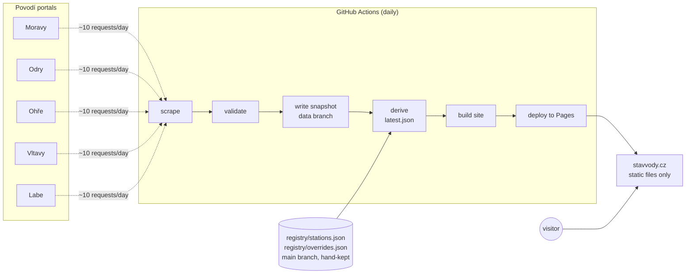

# Design

## Context

See proposal.md for why the site exists, and the specs for what it must do. Constraints that shape the approach:

- The data exists only as HTML tables on five Povodí portals. There is no API. At least four portals run the same MGE Data software with the same three page types.
- The data changes once a day and the audience only reads it.
- Hosting and automation must be free, with no server to maintain.
- Three portals (Vltavy, Ohře, Labe) could not be loaded from a cloud environment during design. Their structure is assumed from the two that loaded.
- The project owner has bought the domain stavvody.cz.



## Goals / Non-Goals

**Goals:**

- One scheduled job is the only thing that talks to the portals.
- Every derived number can be regenerated from stored snapshots and the registry.
- The site keeps working, with honest staleness, when the job stops.
- History features and a database can be added later without losing or converting data by hand.

**Non-Goals:**

- No server-side code at request time.
- No history files or charts in this change (planned for v1.1, see Decision 8).
- No runtime map library or tile server.

## Decisions

### 1. Static site on GitHub Pages, data in the repository

A scheduled GitHub Actions job scrapes, commits a snapshot and redeploys the static site.

Alternatives considered:

| Option | Why not |
|---|---|
| Small server with a database and an API | Hosting cost and upkeep for a once-a-day update; more ways to be offline |
| Serverless functions + object storage | More moving parts and vendor lock-in for the same result |
| Browser calls the portals directly | Puts visitor load on Povodí servers and breaks on cross-origin rules |
| Cloudflare Workers/Pages | Equivalent; worth switching to if the repo must become private or a database (D1) is needed |
| Netlify, Vercel | Bandwidth caps, Vercel's free tier is non-commercial only, nothing gained |

Hosting details:

- Pages source is **GitHub Actions** (`actions/upload-pages-artifact`, `actions/deploy-pages`), so no `CNAME` file is needed.
- Pages on the free plan requires a **public repository**. Code, registry and snapshots are therefore public. Acceptable because the site republishes the same data; relevant while Povodí consent is pending.
- Limits: site ≤ 1 GB (expected < 10 MB), soft bandwidth 100 GB/month (about 200 000 first visits), unlimited Actions minutes for public repos, Pages responses cached for 10 minutes.
- GitHub's terms do not allow Pages primarily for a commercial service. The project is non-commercial.

DNS at the .cz registrar:

| Name | Type | Value |
|---|---|---|
| `stavvody.cz` | A | `185.199.108.153`, `185.199.109.153`, `185.199.110.153`, `185.199.111.153` |
| `stavvody.cz` | AAAA | `2606:50c0:8000::153`, `2606:50c0:8001::153`, `2606:50c0:8002::153`, `2606:50c0:8003::153` |
| `www.stavvody.cz` | CNAME | `<github-user>.github.io.` |

Check these against GitHub's documentation when setting them. Verify the domain in GitHub account settings (TXT record) to prevent takeover, set `stavvody.cz` as the custom domain (www redirects to it), then enable **Enforce HTTPS**.

### 2. Snapshots on a separate `data` branch

```
main                                   data (orphan, bot-only)
├─ openspec/                           ├─ snapshots/2026/2026-11-21.json
├─ design/        canvas exports       └─ status/last-run.json
├─ registry/
│  ├─ stations.json
│  └─ overrides.json
├─ src/
│  ├─ shared/     types, zod schemas, rules, Czech parsing
│  ├─ scraper/    http.ts, portals/mge.ts, sources.ts, run.ts
│  ├─ derive/     latest.ts, run.ts
│  └─ web/        Preact app
├─ public/        map/, fonts/
├─ scripts/       map/ (asset pipeline), registry/ (registry builder)
├─ test/fixtures/<source>/<page>.html
└─ .github/workflows/
```

Why: daily bot commits stay out of the code history, `main` stays small, and the whole data history can be exported by copying one branch.

Raw HTML is **not** committed. Each run uploads the fetched pages as a gzipped Actions artifact kept for 90 days, which satisfies raw page retention without growing the repository.

Alternative considered: snapshots on `main`. Rejected because 365 bot commits a year would bury code changes.

### 3. Scraper on a GitHub-hosted runner, with a Czech fallback

Default: `ubuntu-latest` (US datacenter IPs). A probe workflow tests every portal from that runner before anything else is built.

If any portal blocks it: a small Czech machine (Raspberry Pi at home or a cheap Czech VPS) runs `pnpm scrape` from cron and pushes the snapshot to `data` with a **deploy key limited to this repository**. The push triggers the deploy workflow.

Rejected: registering that machine as a self-hosted Actions runner. On a public repository a self-hosted runner can be made to execute code from outside contributors.

Scraper behaviour:

- One parser for the MGE Data software (`portals/mge.ts`), configured per source in `sources.ts`. If a portal needs ASP.NET postbacks (`__VIEWSTATE`) to show all rows, the adapter replays the form post as a single request.
- User-Agent: `stavvody.cz-bot/1.0 (+https://stavvody.cz/o-datech; <project contact email>)`.
- Timeout 30 s; retries after 5 s and 20 s.

| Source | Povodí | Base URL | Verified |
|---|---|---|---|
| `pmo` | Moravy | `https://sap.pmo.cz/portal/Nadrze/cz/pc/` | yes |
| `pod` | Odry | `https://www.pod.cz/portal/Nadrze/cz/pc/` | yes |
| `poh` | Ohře | `https://sap.poh.cz/portal/nadrze/cz/pc/` | no |
| `pvl` | Vltavy | `https://www.pvl.cz/portal/Nadrze/cz/pc/` | no |
| `pla` | Labe | unknown; gauge portal at `pla.cz/portal/sap/` uses the same software | no |

Pages: `Prehled.aspx` (daily), `Objemy.aspx` (daily), `Mereni.aspx?id=…&oid=…` (registry build only).

### 4. TypeScript with Vite and Preact

| Area | Choice | Why |
|---|---|---|
| Language | TypeScript everywhere | One toolchain for scraper, derive step and front end |
| Runtime | Node.js 22 LTS | Native `fetch` |
| Package manager | pnpm | – |
| HTML parsing | cheerio | Static HTML, no browser needed |
| Validation | zod | Schemas shared by scraper, derive step and tests |
| Time zones | `date-fns-tz` or the Temporal polyfill | Europe/Prague with DST |
| Front end | Vite + Preact | About 4–6 KB of runtime versus about 45–60 KB for React; one screen with light interaction |
| Tests | Vitest; one Playwright smoke test | – |
| Lint/format | ESLint + Prettier | – |

Alternatives considered: React (fits but uses most of the JS budget on the library) and React code compiled to Preact through `preact/compat` (kept as an escape hatch if a needed library expects React). The owner chose plain Preact.

Fonts (Outfit, Inter) are **self-hosted** so visitor IPs are not sent to Google, which also avoids a consent banner.

### 5. Map geometry projected at build time

Projection: Lambert conformal conic fitted to Czechia, `+proj=lcc +lat_1=49 +lat_2=50.5 +lat_0=49.8 +lon_0=15.5 +ellps=WGS84`. Border (Natural Earth), rivers (DIBAVOD or OpenStreetMap, simplified with mapshaper), cities and stations are projected with proj4 into one SVG coordinate space during the build. The hillshade raster is warped to the same projection and extent with GDAL and exported as WebP at 880 px and 1760 px. The browser draws plain SVG over an image and does no projection math.

The asset pipeline lives in `scripts/map/` with a README listing every command and source download. It runs on a developer machine and its outputs are committed.

Alternative considered: MapLibre with vector tiles. Rejected for v1 because it adds a large library and a tile source for a map that does not zoom. It stays the path if free zooming is ever wanted.

### 6. Data model

Names speak of **stations**, not reservoirs, so river gauges fit in for v2. Every file carries `schemaVersion`.

`registry/stations.json` (hand-kept):

```ts
type Station = {
  id: string;                 // "pod-slezska-harta": source code + slug, never changes
  kind: "reservoir";          // v2 adds "river-gauge"
  name: string;
  source: "pmo" | "pod" | "poh" | "pvl" | "pla";
  basin: "moravy" | "odry" | "ohre" | "vltavy" | "labe";
  river: string;
  portalId: { id: string; oid: string };   // from the Mereni.aspx link
  sourceUrl: string;
  lat: number; lon: number;   // WGS84
  levels: {                   // m a.s.l.; null if not defined for this dam
    crest: number | null; spillway: number | null; maxRetention: number | null;
    storage: number | null; permanent: number | null;
  };
  heightDatum: string;        // usually "Bpv"
  storageVolume: number | null;   // mil. m³
  purposes: ("drinking" | "recreation" | "hydropower" | "flood")[];  // collected, not shown in v1
  preferRow?: "default" | "recalculated";
  hidden?: boolean;
};
```

`registry/overrides.json` (hand-kept):

```ts
type Overrides = Record<string, { status: "planned"; reason: string; from?: string; until?: string }>;
```

`snapshots/YYYY/YYYY-MM-DD.json` (data branch, parsed values only):

```ts
type Snapshot = {
  schemaVersion: 1;
  fetchedAt: string;  // UTC
  sources: Record<SourceCode, "ok" | "failed" | "blocked" | "partial">;
  stations: Record<string, {
    measuredAt: string | null;   // Prague time with offset
    level: number | null; volume: number | null;
    inflow: number | null; outflow: number | null;
    storageFilled: number | null | "undefined-zone";
    storageFilledPct: number | null | "undefined-zone";
    retentionFilled: number | null | "undefined-zone";
    note: string;
  }>;
  unmatched: { source: SourceCode; name: string; raw: Record<string, string> }[];
};
```

`/data/latest.json` (published, under 50 KB gzipped):

```ts
type Latest = {
  schemaVersion: 1;
  builtAt: string;
  lastSuccessfulFetch: string;
  sources: Snapshot["sources"];
  stations: Array<{
    id: string; name: string; river: string; basin: string;
    x: number; y: number; r: number;         // pre-projected, after overlap handling
    buildStatus: Status;                     // status at build time; the browser re-applies the 36 h rule
    fillPct: number | null; fillPctRaw: number | null;
    storageFilled: number | null; storageVolume: number | null;
    level: number | null; volume: number | null; inflow: number | null; outflow: number | null;
    levels: Station["levels"];
    changeCm: number | null;
    measuredAt: string | null;
    isLastKnown: boolean;                    // values from an older snapshot because the source failed
    note: string | null;
    sourceUrl: string;
  }>;
};
type Status = "no-data" | "planned" | "above-storage" | "unrated" | "high" | "medium" | "low";
```

The headline numbers are **computed in the browser** from `stations`, because they must follow the visitor-side 36-hour rule (national-summary spec, "Headline follows staleness").

### 7. Staleness evaluated in the browser

If scraping stops, no build runs, so statuses written at build time would never turn grey. The front end therefore applies the 36-hour rule against the visitor's clock to every station and to `lastSuccessfulFetch`, then computes the headline. Everything else is derived at build time.

### 8. No database; history files later

Expected volume: about 150 stations × 365 days ≈ 55 000 rows a year, 15–20 MB of JSON. Even hourly readings would be about 1.3 million rows a year.

v1.1 adds `/data/history/<id>.json` (columnar, about 15 KB per station per year) and `/data/history/_national.json`, regenerated from the `data` branch on every build.

Move to a database only for ad-hoc cross-station queries, high-frequency river gauges, or a public API, cheapest first: a SQLite or DuckDB file built in CI and queried in the browser; Cloudflare D1 behind a Worker; Postgres on a VPS. Each is an import of the `data` branch.

### 9. Workflows

Commits pushed with the default `GITHUB_TOKEN` do not start other workflows, so `scrape.yml` **calls** `deploy.yml` as a reusable workflow.

| Workflow | Triggers | Does |
|---|---|---|
| `probe.yml` | manual | Fetches robots.txt, overview and volumes pages of every source; prints status codes and row counts; uploads the pages. No commit. |
| `scrape.yml` | `schedule: "17 6 * * *"` (07:17 CET, 08:17 CEST), manual | Scrape, validate, commit snapshot to `data`, write `status/last-run.json`, upload raw pages, ping the health check, call `deploy.yml`. |
| `deploy.yml` | `workflow_call`, push to `main`, push to `data`, manual | Derive `latest.json`, build, deploy to Pages. |
| `ci.yml` | pull request, push to `main` | Lint, type check, tests, build. |

`contents: write` only in `scrape.yml`; `pages: write` and `id-token: write` only in `deploy.yml`. One scrape and one deploy at a time. Third-party actions pinned by commit SHA.

`latest.json` is fetched with `?v=<build id>` written into the HTML, so a new deploy is picked up despite the 10-minute Pages cache.

### 10. Operations

- A failed scheduled run emails the person who last changed the cron line in `scrape.yml`.
- A dead-man's-switch check (e.g. healthchecks.io, free) is pinged after each successful scrape and emails the owner when no ping arrives for 36 hours. This also catches GitHub disabling scheduled workflows after 60 days of repository inactivity, or skipping runs under load. The ping URL is a repository secret.
- After a parser fix, `pnpm reparse --from <date>` regenerates snapshots from the kept raw pages.
- A planned drawdown is added by a pull request to `registry/overrides.json`; merging redeploys the site.

## Risks / Trade-offs

- [Portals block GitHub's US IPs] → Probe first; Czech fallback machine with a repository-scoped deploy key (Decision 3).
- [Portal layout changes] → Validation guards fail the run, previous data stays live, owner is emailed; parser fix plus re-parse from raw pages.
- [Legal: Czech database law may cover systematic daily copying; Povodí consent pending] → Non-commercial, attribution and "data bez záruky" on every card, unofficial notice; removing a source is one line in `sources.ts`, and its past snapshots can be removed from the `data` branch if asked.
- [Public repository exposes snapshots] → Same data as the site; revisit hosting (Cloudflare with a private repo) if a Povodí objects to the raw archive.
- [Scheduled runs delayed or silently disabled] → Off-the-hour cron, dead-man's-switch alert, browser-side staleness.
- [Map too crowded at the real station count, possibly ~140] → Overlap handling first; then the owner chooses regional zoom, hiding the smallest circles on the map, or leader lines (tasks 9.4).
- [70 % and 40 % thresholds are a guess] → One constant; reviewed against real data before launch; snapshots allow re-deriving.
- [Map data licences] → DIBAVOD, OpenStreetMap (ODbL), Natural Earth, the elevation model (e.g. Copernicus DEM) checked and credited before launch.

## Migration Plan

First deployment, no existing system:

1. Create the public repository and the orphan `data` branch.
2. Run `probe.yml`; choose GitHub-hosted runner or the Czech fallback.
3. Enable Pages with source "GitHub Actions"; deploy once to the default `github.io` address.
4. Set DNS, verify the domain, set the custom domain, enable HTTPS.
5. Let the scheduled job run for seven days before announcing the site.

Rollback: re-run `deploy.yml` from an earlier commit of `main`; a bad snapshot is reverted on the `data` branch and the site redeployed.

## Open Questions

None of these change the specs, the approach or the tasks:

- Display name: "Stav vody" to match the domain, or another name? (Owner)
- Project contact email for the User-Agent and the footer. (Owner)
- Code licence; MIT suggested. (Owner)
- The Czech label for a station with no storage zone defined, if the design wants one beyond "mimo hodnocení". (Owner)
